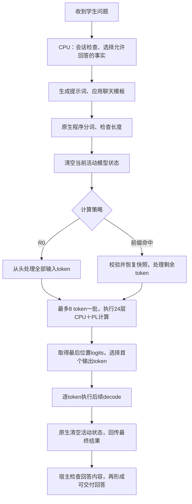

已停止刚才的修复任务，**本轮没有连接或读取板卡**。下面按v3实际执行的冻结版本说明；刚才新增的CMA修复候选尚未完成最终复核，也未部署。

先明确一个关键区别：目前流程包含**模型计算、运行保护、数值验收、性能诊断**四部分。它们的作用和删减空间不同。尤其是，**1.14 GiB原件来自数值验收，普通应用请求本身已经关闭了大部分重型诊断。**

下面使用旧窗口的“107-token输入、70-token公共前缀、命中后新算37-token”举例。新精简提示词的token数尚未重新验证，不能继续套用这些数字。

---

**一次普通应用请求，大致经过下面这条路径：**



**1．进入模型之前，CPU先处理应用逻辑**

收到问题后，`Session.submit()`会做这些工作：

- 检查会话是否结束、是否有上一条回答等待交付。
- 检查请求ID，防止同一ID对应不同问题或重复执行。
- 解析问题，决定回答、澄清或拒绝。
- 从病例中选出本轮允许披露的事实。
- 保存问题及事实规划的审计信息。
- 生成system和user消息，再应用聊天模板。

只有进入“回答”分支，才调用模型。澄清、拒绝等分支可以直接使用模板。

你刚修改的短提示词作用于这里。它能减少输入长度，但**事实选择、数字单位检查、肯否检查等宿主逻辑仍然存在**。

应用测试还会检查“实际生成的提示词是否与冻结输入完全一致”。这是为了避免测着测着换了输入，属于实验一致性检查。

---

**2．原生程序先分词，再准备状态**

普通应用把完整提示词交给原生程序，原生程序执行分词，然后检查：

- token是否合法；
- 输入加输出是否超过上下文；
- 输出上限、分块参数是否合法；
- 当前选择的是R0还是前缀命中策略。

随后，程序会**清空当前活动的模型状态**。

这里清空的是当前上下文中的注意力、循环状态等；独立保存的公共前缀快照可以继续保留。

这一步与会话隔离有关：上一轮生成过、被拒绝或尚未交付的内容，不能混进下一轮。旧记录中这类reset耗时约为毫秒级，通常不是最值得先删减的地方。

---

**3．R0和前缀命中，分别怎样开始prefill**

| 路径 | 实际动作 |
|---|---|
| R0 | 清空活动状态，从第一个输入token开始处理 |
| 前缀命中 | 检查快照身份和完整性，恢复模型状态，再处理剩余token |

前缀命中并不是只判断“文字开头相同”。当前代码还检查：

- token前缀是否完全一致；
- 模型、程序、库和运行配置的绑定是否一致；
- 快照属于公共前缀还是某个病例／会话；
- 保存的状态和logits摘要是否正确；
- 恢复后的状态位置和独立状态摘要是否符合预期。

Qwen3.5使用混合注意力结构。当前模型有24层，其中18层是线性注意力、6层是完整注意力，所以快照需要覆盖相应的循环状态和KV等内容。

旧窗口保留的一份前缀快照约21 MiB。CPU普通命中样本中：

- 查找及完整性检查约251 ms；
- 恢复及恢复验证约271 ms。

这是约半秒的开销，有优化空间，但它承担着复用正确性的检查。

另外，**公共前缀要先预计算一次**。`warm_prefix`就是先计算公共部分、捕获快照。后续请求才能省算。这笔预热成本适合由多个请求摊销，当前热请求TTFT没有包含完整冷启动和预热等待。

---

**4．真正的prefill计算：CPU和PL分别做什么**

当前PL负责每层MLP中的三个线性投影：

| 运算 | 当前执行位置 |
|---|---|
| embedding、归一化 | CPU |
| 注意力相关投影、注意力／循环状态更新 | CPU |
| MLP gate投影 | PL |
| MLP up投影 | PL |
| 激活函数、逐元素乘法等 | CPU |
| MLP down投影 | PL |
| 残差、最终归一化、词表输出 | CPU |

因此，PL参与计算时，CPU仍有大量工作。

输入在原生接口中可以按较大块交给运行时，但内部的**物理微批最多为8个token**。所以，`prefill_chunk=256`并不代表PL一次处理256个token。

对于旧107-token样例：

- 分为14个物理微批；
- 每个微批经过24层；
- 每层有gate、up、down三个PL投影。

对应prefill调用数：

\[
14\times24\times3=1008
\]

前缀命中后只处理37个新token：

\[
5\times24\times3=360
\]

每次投影之前，CPU还需要整理激活数据、量化为A8及计算缩放因子。gate和up使用相同输入时，当前代码已经共享量化结果，减少了一次重复量化。

权重W4是在准备阶段形成的；72份权重在worker启动时加载并驻留，**不会每次PL调用都重新加载全部权重**。

---

**5．每一次PL投影，外面还有一圈管理和完成检查**

当前每次PL调用大致是：

```text
整理并量化输入
  ↓
向管理器申请本次提交许可
  ↓
管理器检查身份、锁、租约、健康和预算
  ↓
许可记录写入并fsync，再回复允许
  ↓
复制输入到BO，执行必要同步
  ↓
启动核并等待完成
  ↓
读取meta，核对本次任务身份和完成状态
  ↓
同步输出，检查输出有效性
  ↓
将结果交回模型计算图
```

管理器每次许可的检查主要包括：

| 检查 | 作用 |
|---|---|
| 请求PID、序列号、阶段和job顺序 | 防止过期、重复或越序请求 |
| 活动租约、两个锁的归属 | 保证唯一维护者和排他执行 |
| 管理器自身映射 | 保持管理与设备访问边界 |
| boot及内核日志 | 检测启动变化和新增异常 |
| 温度、MemAvailable、CmaFree | 资源准入 |
| 提交次数、权重加载次数、截止时间 | 限制窗口范围 |
| 持久许可日志 | 先留存授权记录，再允许操作 |

这里有两个容易混淆的地方：

- 当前内核日志读取已经采用增量机制，并非每次重新执行一次完整`dmesg`。
- 全系统FD/VMA扫描主要位于维护窗口前后；每次许可中的自身映射、锁检查与它不是同一套扫描。

PL完成后，还必须确认本次结果对应正确的job和核版本，完成标志及meta有效，输出可消费。随后CPU才继续后面的模型计算。

**这一圈检查在普通PL请求中仍然存在。关闭完整诊断，不会自动去掉它们。**

---

**6．首token、后续decode和回答检查**

prefill结束后，模型取得最后输入位置的logits，也就是对词表中每个token的预测分数。当前使用greedy选择首个输出token。

首个token可以直接从prefill的logits中选出，通常不需要先额外做一轮decode。

之后生成下一个token时，才继续执行单token decode。当前每轮decode仍会经过24层，因此每轮对应72次MLP投影。

完整生成结束后：

1. 原生程序清空活动模型状态并回传最终结果；
2. 宿主检查候选回答是否覆盖事实、数字单位和肯否等关系；
3. 再检查最终准备交付的文本。

这些内容检查发生在完整回答形成之后，通常不属于模型prefill。当前记录的应用TTFT是**应用内部收到首个模型token的时间**；学生拿到通过检查的完整回答，还要等待后续生成和内容检查。

---

**额外诊断具体有哪些，普通请求是否已经关闭？**

这是最值得你用来决定删减的表：

| 项目／开关 | 额外工作 | v3普通应用请求 |
|---|---|---|
| `diagnostic_dir` | 保存投影输入输出等二进制原件 | 已关闭 |
| `diagnostic_all_layers` | 将转储扩展到全部MLP层 | 未启用 |
| `logits_mode='all'` | 计算并取得每个输入位置的完整词表输出 | 已使用`final` |
| `dump_state` | 序列化并保存prefill状态原件 | 已关闭 |
| `state_fingerprint` | 序列化状态，计算完整指纹 | 已关闭 |
| `profile` | 逐阶段、逐算子计时统计 | 已关闭 |
| `profile_detail` | 更细的节点、形状及分层统计 | 未启用 |
| `a12_consumer_trace` | 对PL输出及图消费者进行额外哈希追踪 | 未启用 |
| `diagnostic_nodes` | 保存选定中间节点数据 | 未启用 |
| 大型内存／映射诊断报告 | 读取smaps等详细驻留信息 | 普通结果未启用重型报告 |
| 完整R0与warm＋hit原件比较 | 重新读取投影、logits和状态，逐字节核对 | 位于前面的数值验收阶段 |
| `FILE_HASHES.json`扫描 | 再次遍历原件形成文件哈希清单 | 位于验收结束阶段 |

普通请求仍会产生少量结果元数据，例如状态、输出token、EOS、末位置logits摘要及缓存命中信息。

**尤其值得注意的是`logits_mode='all'`。**

当前词表大小为248,320，每个位置一份float32 logits约0.95 MiB。对107个输入位置全部计算：

- 会多做大量CPU词表输出计算；
- 会产生大量logits数据；
- 开启转储后，还要写盘、同步和回读。

普通生成主要需要最后输入位置的logits。公共前缀预热也需要保存末位置logits，供完整前缀命中等情况使用；日常预热原则上没有必要保留每个位置的全套logits。切换模式仍需一次等价验证。

---

**当前验收窗口为什么看起来特别长？**

每个后端都安排了六项请求：

| 顺序 | 请求 | 目的 |
|---|---|---|
| 1 | `diag_exact` | 短样例对照旧版本 |
| 2 | `warm_prefix` | 生成前缀快照，并保存验证原件 |
| 3 | `diag_full_R0` | 保存完整计算原件 |
| 4 | `diag_hit` | 保存命中后的原件，做完整一致性比较 |
| 5 | `app_R0` | 测普通应用从头计算 |
| 6 | `app_hit` | 测普通应用前缀复用 |

CPU先做一轮，PL再做一轮。**这是一套验收流程；正常回答一个问题，无需把六项都执行一遍。**

第4项结束后，旧管理器还会重新读取约520 MiB原件，核对“完整计算＝公共前缀＋剩余计算”。约35秒核对发生在原生结果返回之后，因而：

- 不属于刚才那次原生prefill计时；
- 会增加整个验收窗口的等待；
- 可能留下页缓存压力，影响接下来的普通应用准入。

v3是在这之后发现CMA不足，PL普通应用R0/hit未完成。

---

**从实际耗时看，哪些步骤值得优先研究？**

下面是旧v3的**重型诊断请求**，不能当作普通应用性能：

| 观察项 | 完整R0 | 前缀命中 |
|---|---:|---:|
| 新算token | 107 | 37 |
| prefill PL调用数 | 1008 | 360 |
| 原生prefill时间，含诊断负担 | 108.91秒 | 38.33秒 |
| 其中：原生等待提交许可 | 16.33秒 | 6.12秒 |
| 管理器所有权检查 | 1.86秒 | 0.66秒 |
| 管理器健康检查 | 4.93秒 | 1.94秒 |
| 管理器记录处理 | 8.34秒 | 3.09秒 |

这些是不同层级的计时，**不能把整张表相加**。例如，管理器记录处理已经包含在许可等待中；其中仅许可日志`fsync`就分别约7.78秒和2.89秒。

这里还有两种不同的`fsync`：

- **诊断原件的fsync**：完整转储时使用，日常路径可以不开这些转储。
- **许可日志的fsync**：每次PL提交前使用，普通请求仍有。删掉它会改变授权记录的持久性设计，需要单独评审。

此外，旧诊断样本的PL输出检查累计约2.47秒／0.85秒，紧凑完成报告累计约0.34秒／0.12秒。它们存在优化空间，但前者检查输出有效性，后者当前已经使用紧凑报告，不能按“每次都打印全部权重”来估算收益。

---

**如果现在由你来挑步骤，我建议按下面的顺序考虑。**

1. **先精简验收编排。** 将完整数值取证与普通性能测量明确分开。稳定版本完成一次充分验证后，后续性能窗口可以按适用范围引用已有证据，减少重复生成整套原件。新提示词、输入或实现变化，需要相应的新验证。
2. **普通运行保持轻量配置。** 不开全层转储、全位置logits、状态转储、细粒度profile和消费者追踪。这里多数已经关闭，主要收益是减少整窗负担和CMA压力，不能把它们再次算作普通TTFT可节省的时间。
3. **合并重复读取和统计。** 同一次原件读取同时完成数值比较与文件哈希，避免再扫描一遍；资源观测采用有界频率。这是刚才暂停的候选所针对的工作。
4. **再研究始终存在的运行开销。** 每次PL许可、日志持久化、输出检查和CPU侧计算确实占时间。可以研究减少重复处理、合并数据遍历；改变检查频率或持久化顺序，需要重新设计与验证。
5. **保留计算与状态边界的正确性。** BO同步、完成meta核对、前缀身份与恢复验证、活动状态清理，都与“结果是否可信、是否串用上一轮状态”直接相关。

最值得先决策的是：**完整诊断究竟只做一次验收，还是每个性能窗口都重复做。** 这对实验耗时和CMA压力影响很大。至于普通应用TTFT，接下来应重点看新提示词缩短后的实际计算量，以及仍在每次PL提交中执行的管理开销。

本轮仅做流程梳理，没有删改任何步骤，也没有继续运行刚才的修复或验证任务。依据主要来自[原生执行代码](C:/Patientqwen/evidence/model_pl_A/20261024-ttft10-01-v1/source-04/main.cpp)、[v3验收编排](C:/Patientqwen/evidence/model_pl_A/20261024-ttft10-01-v1/window-20261025-v3/bundle-v4/platform/qwen35/a12/tt10_01_case.py)和[逐次许可管理器](C:/Patientqwen/evidence/model_pl_A/20261024-ttft10-01-v1/window-20261025-v3/bundle-v4/platform/qwen35/a12/cpu01b_supervisor.py)。TT10-01仍未完成。
