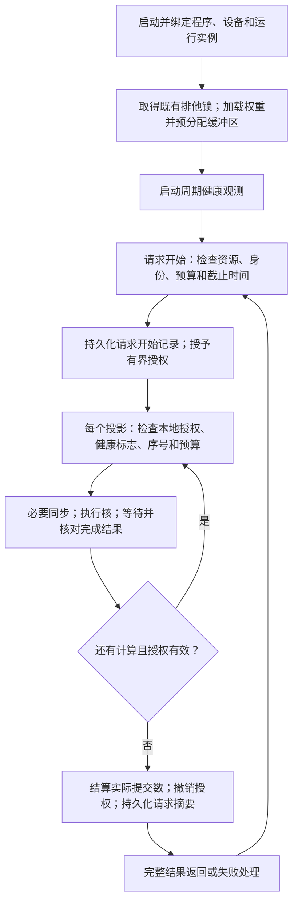

# A12 许可检查改动建议：以低延迟推理为目标

日期：2026-10-25  
状态：设计建议，尚未实施、部署或板卡验证  
适用对象：A12 普通推理路径中的逐次 PL 提交许可与配套管理检查

## 1. 推荐决策

建议将当前“每次投影前进行完整许可检查”改为：

> 启动时完成静态验证，请求开始时完成准入和有界授权；运行期间周期观测健康状态；每次投影仅执行轻量本地检查、必要的数据同步和完成核对。

实施先后顺序：

1. **先取消普通推理中逐投影许可日志的同步落盘**，保留请求级持久记录与内存明细；暂时保留现有逐次许可往返，单独测量收益。
2. **迁移重复检查**：身份、映射、锁归属等移到启动或请求边界；温度、内存、内核日志移到周期监控。此阶段也可继续保留轻量逐次许可，避免同时改变所有机制。
3. **再减少许可往返次数**：先试每个物理微批一次授权，验证撤销、超时和退出路径后，再使用每个请求一次有界授权。每次投影仍在执行进程内检查预算、截止时间、故障和取消状态。

普通推理与严格验收保留两种明确模式。既有逐次持久许可流程可作为严格模式及回退基线，不必为了优化普通推理而删除历史验收能力。

这属于许可与检查粒度调整；本建议不改变模型、量化、CPU/PL 运算分工、数值容差、前缀算法或 PL 核实现。

## 2. 依据、已知限制与性能判断

### 2.1 证据边界

本建议依据用户提供的 [A12 流程与诊断说明](C:/Users/陈沐阳/Downloads/A12_PREFILL_FLOW_AND_DIAGNOSTICS_20261025.md)。

该说明引用的 `cpu01b_supervisor.py`、`tt10_01_case.py` 在本轮检查的原始绝对路径下不存在；本轮也没有在当前工作区发现这两个同名源文件。因此：

- 已知行为和历史数据来自该说明，不等同于对当前运行代码完成了审计。
- 下文的接口字段、状态名称、周期和验收目标均为建议，不是现有实现事实。
- 两个锁的准确保护范围、租约执行者、设备实际访问路径、动态 BO 分配位置，必须在实施前从实际代码确认。
- 用户说明已完成若干版本验收；实施仍需绑定实际准备优化的版本，不能默认旧 v3 数据代表当前版本。

### 2.2 不能直接认定许可是最大瓶颈

| 旧 v3 重型诊断数据 | 完整 R0 | 前缀命中 |
|---|---:|---:|
| 输入中实际新算 token | 107 | 37 |
| prefill PL 投影数 | 1008 | 360 |
| 原生 prefill 时间 | 108.91 秒 | 38.33 秒 |
| 原生等待许可 | 16.33 秒 | 6.12 秒 |
| 许可等待占 prefill 比例 | 约 15.0% | 约 16.0% |
| 其中许可日志 fsync | 7.78 秒 | 2.89 秒 |

以上说明许可有显著优化价值，但尚不能证明其为全部耗时中的第一大项。管理器内部计时嵌套在许可等待中，不可重复相加。

以旧数据作静态估算：即使完整消除许可等待，且其余成本不变，prefill 加速也只有约 1.18～1.19 倍；实际不能把必要检查全部消除。逐次 fsync 约占旧 prefill 的 7%～8%，这些数字均非普通推理的收益承诺。若管理等待还引起调度或缓存副作用，新测结果可能不同。

旧说明中 PL 普通请求未完成；新短提示词的 token 数也未验证。应先取得当前版本轻量普通请求基线，再谈绝对延迟和目标达成。

## 3. 每项检查移到哪里、如何调整

| 当前检查 | 推荐位置 | 普通推理的具体改动 | 必须保留的约束 |
|---|---|---|---|
| 请求 PID | worker 建立连接/注册时；连接重建时重查 | 绑定实际连接对端和 worker 实例；删除每次投影重复读取进程信息的工作。PID 只作辅助标识，不能单独代表实例。 | 重启后的新进程必须重新注册；旧连接和旧授权失效，不能因 PID 恰好相同而复用。 |
| 请求序列号、阶段、job 顺序 | 每次提交的本地执行入口；授权边界 | 保留便宜的内存计数和阶段检查，避免为核对一个整数再发一次管理器请求。请求、微批、层及 gate/up/down 的对应关系应由已有执行图生成。 | 重复、越序、越预算提交在启动核前被拒绝；完成 meta 仍须对应当前 job。 |
| 活动租约 | 请求开始；续期/撤销时；每次投影本地看有效期 | 授权有效期覆盖有界请求，使用单调时钟；逐投影本地比较期限，不逐投影读取租约文件。长请求需要续期时只在组边界进行。 | 过期/撤销后不能再启动新投影；已提交核先完成或走已验证恢复流程，再移交设备。 |
| 两个锁的归属 | worker/维护窗口建立时获取；请求开始确认协议状态 | 先保持现有两个锁及获取顺序，持续持有对应锁句柄；删除逐投影对锁文件、归属元数据的重复遍历。暂不合并两个锁。 | 锁覆盖所有设备操作者，生命周期不能留下空档；不能只依赖 PID 文件或“看起来空闲”。 |
| 管理器自身映射 | 管理器启动；设备打开/重配；已知会改变映射的操作之后 | 启动验证一次，设备生命周期变化时重验；普通投影前不重复解析自身映射。若现有隔离协议要求持续约束，先确认等价保证再迁移。 | 管理器与实际执行者的设备访问边界仍有效。不能只保存一次检查结果，却允许未受控的后续映射变化。 |
| boot 身份 | 管理器启动、worker 注册、恢复连接时 | 绑定运行实例；删除逐投影读取同一启动标识。设备重置另行失效，不能只靠 boot 标识检测。 | 主机重启、管理器重启、worker 重启、设备重配均不得沿用不适用的旧授权。 |
| 新增内核日志 | 周期健康监控；设备操作报错时立即补查；请求结束汇总 | 延用增量游标，移出逐投影关键路径；每次投影读取监控器发布的故障标志。 | 保留驱动报错和完成状态检查；日志延迟不应成为唯一故障发现机制。日志轮转/缺失需明确记录。 |
| 温度 | 启动/请求准入；周期监控 | 普通请求复用最新、未过期采样；逐投影只看健康状态。建议从 1 秒周期起试验，不作为板卡安全阈值。 | 保留平台原有热保护及既有温度阈值。采样频率需满足已知温升和响应要求，不能仅凭性能目标确定。 |
| MemAvailable | 请求准入；周期监控；新增大内存分配前 | 不再为每个无新增分配的投影读取 `/proc/meminfo`。 | 真实分配失败必须处理；采样通过不保证之后分配成功。 |
| CmaFree | BO/权重分配或扩容前；初始化后；周期监控 | 先确认权重、输入输出及 meta BO 的实际分配位置。对完全复用既有 BO 的投影，去掉逐次 CMA 准入；分配路径仍保留检查。 | 不因 CmaFree 低于旧门槛就机械拒绝无需新 CMA 的计算；仍需考虑驱动实际动态需求。CmaFree 不是最大可分配连续块保证。 |
| 提交次数预算 | 授权时确定；每次投影本地扣减 | 预算以实际执行图和输出上限计算，启动核前原子/串行扣减；请求结束汇总给管理器。 | 重试也计入实际提交次数，或使用明确的独立重试额度；不能在失败重试时重置预算。 |
| 权重加载次数 | worker 初始化及权重加载入口 | 推理阶段默认不允许再加载；仅在真实加载接口更新计数。普通投影无需向管理器反复证明“没有加载”。 | 重新加载/切换模型必须走受控生命周期，旧请求授权失效；不能存在绕开计数的加载入口。 |
| 截止时间 | 请求/组授权时确定；每次投影本地检查；等待完成时使用剩余期限 | 使用单调时钟比较，去掉为查询截止时间而进行的 IPC 或文件读取。 | 统一处理排队、计算与取消的时间预算。停止提交与中止已运行核是两件事。 |
| 持久许可日志 | 请求开始和请求结束；异常汇总 | 删除每次投影前的写盘与 fsync；保留请求开始记录同步持久化、请求结束摘要同步持久化；逐投影明细放有界内存。 | 明确改为“请求级持久授权、逐投影明细不保证掉电保存”。这不是与旧逐次持久授权完全等价的修改。 |

Linux 的 `flock` 是协作式锁；如果项目实际使用它，所有可能访问设备的工具都必须遵守同一协议。它不能自动拦住无视协议的进程，也不能仅凭控制进程退出推断板卡已无在途任务。[Linux flock 文档](https://man7.org/linux/man-pages/man2/flock.2.html)

## 4. 明确删减、保留及暂缓的内容

### 4.1 从普通投影关键路径删除

- 每次许可前的日志文件打开/关闭、格式化完整历史、同步持久化。
- 每次重新读取 PID 身份、boot 标识、静态映射和锁归属证据。
- 每次读取温度、内存、CMA 和新增内核日志；改由健康监控提供缓存状态。
- 同一份健康数据在管理器和执行者之间重复采集、解析。
- 重复序列化整套授权上下文，只为许可一个已在预算内的投影。

这里的“删除”指从普通投影路径删除重复工作；对应机制迁移到第 3 节指定位置。不要在没有替代生命周期约束时直接注释掉所有检查。

### 4.2 每次投影继续保留

- 当前请求/授权实例有效、未撤销、未过期、监控状态未失效。
- 本地提交序号、阶段与预算检查。
- 输入形状、数据长度、BO 范围及必要的核参数检查；已冻结的不变量可在初始化验证，动态量仍检查。
- 必要的输入/输出同步、核启动、等待完成及错误处理。
- 当前 job 的完成状态、必要 meta/核兼容性标识核对，以及输出可消费性检查。

XRT 官方执行流程包含缓冲区管理和同步、核启动、运行完成等待；本建议不把这些基础正确性工作算作可随意删除的许可负担。[XRT 2024.2 文档](https://xilinx.github.io/XRT/2024.2/html/xrt_native_apis.html?highlight=xrt+bo)

### 4.3 本轮不建议顺带改动

- 前缀身份/恢复验证、会话活动状态清理、回答事实检查。
- 输出逐元素有效性检查的具体算法；若未来要采样或融合扫描，另作数值正确性评估。
- 两个锁的合并，硬件隔离权限的扩大，或者多 worker 并发调度。
- 模型、提示词、量化策略、PL 核、微批上限。
- 移除既有硬件热保护，或设置没有实测依据的新温度/CMA 阈值。

## 5. 推荐的运行流程

该图展示最终请求级授权目标。中间验证版本可以每个物理微批走一次授权边界，内部仍执行相同的轻量本地检查。

### 5.1 授权范围必须有界

授权至少绑定以下逻辑信息，优先复用现有字段，不必创建新的复杂协议框架：

| 信息 | 用途 |
|---|---|
| 管理器和 worker 实例身份、设备代次 | 拒绝进程重启、设备重配后的旧授权 |
| 请求 ID、授权编号 | 不同请求不可串用 |
| 模型/配置身份或初始化上下文引用 | 防止配置变化后继续使用旧许可 |
| 允许的阶段、job 范围、最大提交次数 | 阻止越界执行 |
| 单调截止时间、撤销状态 | 停止超时或取消后的新提交 |

预算不应硬编码为“107 token”或“1008 次”。在现有 24 层、每层三个 PL 投影、微批上限 8 的结构下，可用 `72 × ceil(N_new/8)` 估计 prefill 投影数，再从实际执行图核对。decode 预算按实际后续 decode 次数计算，每轮 72 次；首输出 token 可直接来自 prefill logits，不应机械多算一次 decode。warm_prefix、R0、hit 各自使用相应计划。

### 5.2 减少 IPC 的适用前提

将检查放在 worker 内，意味着管理器信任该执行进程正确实施本地约束。这适合本项目受控、单 worker 的普通推理优化目标，但不是对任意不可信进程的强隔离方案。

- 必须确认管理器角色是协作式运行管理，而非必须逐次独立裁决的安全边界。
- 若 worker 不可信、无法可靠接收撤销，或管理器不能确认旧 worker 已退出/停止访问设备，先停留在“轻量逐次许可”版本，不启用请求级授权。
- 设备所有权通过既有锁及访问协议维持；不要因授权超时就强行启动另一个执行者。

### 5.3 监控与异常处理

建议先复用现有管理器的监控能力；若它只有阻塞式处理循环，应确认监控不会因一次长等待而停止。需要时增加一个最小的独立观测任务，不引入新的监控服务体系。

- 初始试验参数：每 1 秒观测一次健康状态；超过 3 秒无成功观测，停止新提交并报告监控失效。两者均为待验证配置，必须根据平台响应约束调整。
- 每次投影只读一个小型健康快照，包含状态、采样时间及故障原因；发布和读取需保持一致，不能读到半更新状态。
- 驱动/XRT 同步报错、异常完成、meta 不匹配立即置故障，不等待下一次周期采样。
- 取消、管理器失联、租约到期或健康故障：禁止新提交；已经提交的核不能假设自动取消。
- 核卡住时执行既有、已验证的恢复流程；无法确认停止时保持设备不可交接，不自动重复运行同一任务。
- CMA 或普通内存分配失败：明确失败并记录本次分配需求，不能盲目循环重试或清理全系统缓存来掩盖问题。

## 6. 日志策略：建议第一步就实施的修改

### 6.1 普通推理的默认方案

1. 管理器一次写入“请求范围、配置身份、预算、期限”等开始记录，并确认同步持久化成功后才放行该请求。
2. 每个投影只更新固定大小的内存计数/明细，不产生逐次文件写入、fsync 或日志线程确认等待。
3. 请求结束写入实际提交数、耗时、完成/失败原因及结果摘要，执行一次同步持久化，然后关闭请求。
4. 若请求异常，保存已有内存摘要；磁盘操作失败必须体现在状态中，不能伪装为完整审计成功。

正常请求同步日志次数从与 PL 投影数相关，降到请求开始和结束各一次。请求结束落盘可能不影响模型首 token 时间，但会影响完整请求返回时间，性能报告必须包含它。

内存明细使用固定容量；达到容量后允许覆盖旧明细并累加丢弃计数，保留汇总计数，不允许隐式退化为同步写盘。重型明细导出继续只在严格诊断模式启用。

### 6.2 必须接受并记录的语义变化

掉电或进程崩溃后，可以知道该请求曾获授权，但未必知道最后执行到了哪个投影；开始记录本身不能证明每个投影实际执行过。不能把缺失结束记录的请求自动当作未执行，并直接重新提交。

这改变的是授权证据的持久化粒度，不应宣称“与旧模式全部保证完全相同”。本阶段以低延迟为首要目标，建议接受请求级持久记录，并在结果里标注运行模式。

`fsync` 会等待存储完成相应同步，普通缓冲写入不能替代其持久性保证；把 `fsync` 改名为 `flush`、`fdatasync`，或挪到线程后仍逐次等待，都不能当然消除瓶颈。[Linux fsync 文档](https://man7.org/linux/man-pages/man2/fsync.2.html)

恢复时必须使旧授权失效，核实设备与活动任务状态，重新建立排他所有权后才开始新请求。如果创建新的日志文件/目录，持久性实现还应处理目录项同步，不能只考虑日志数据。

## 7. 分阶段实施清单

下面的阶段名只是本建议的实验标签，不是现有代码中的开关名。无需一次开发全部阶段。

### 阶段 0：确认当前实现与普通请求基线

输入：当前准备优化的代码、运行配置、最近一次适用的验收证据和固定测试输入。

工作：

1. 从真实代码定位许可请求入口、管理器处理入口、日志同步位置、BO 分配入口、核启动及完成路径。
2. 写清两个锁、租约及设备访问者的关系；查明哪些检查真正遍历文件、哪些只是内存比较。
3. 确认普通请求没有全层转储、全位置 logits、状态转储和重型 profile。
4. 记录提示词/输入 token、模型及程序版本、R0/hit、预热条件、PL 调用数、实际输出数。
5. 取得普通请求延迟及许可汇总计时；避免新加逐投影落盘来测量逐投影落盘。

输出：当前基线与检查位置清单。若普通请求仍因 CMA 等原因无法完成，先单独解决阻塞并冻结新基线，不用重型诊断结果冒充普通请求结果。

### 阶段 1：只调整许可日志

保持逐次 IPC、检查频率和模型路径不变，只将日志改为第 6 节的请求级持久化。执行固定输入的正确性对比与小规模性能对比。

输出：逐次 fsync 是否已从关键路径消失、完整请求是否仍有结束落盘、实际节省多少时间。

停止条件：出现未记录的日志失败、异常重跑、输出/状态不一致或所有权问题，退回原模式排查。

### 阶段 2：迁移重复检查，保留轻量逐次 IPC

按第 3 节移动静态与周期检查。每次许可回复仍可存在，但只处理轻量状态、序号、预算和故障标志；周期观测独立运行。

输出：每次许可的剩余成本，以及观测故障、取消和超时的实际响应时间。

停止条件：监控停摆仍持续放行，动态映射/分配路径绕开验证，或故障处理不满足现有响应要求。

### 阶段 3：减少许可往返

先每个物理微批一次许可，再决定是否扩到每请求一次。普通 decode 可按每轮一个有界组处理，最终统一到请求预算。重试、取消、EOS 提前结束都必须正确结算。

在旧输入下，若仅讨论 prefill：微批级许可可从 1008/360 次降至约 14/5 次；请求级则为一次开始授权及结束结算。**减少的是许可交互次数，PL 实际投影仍为 1008/360 次，核启动与完成核对也不会随之消失。**

输出：授权范围、撤销协议、旧授权失效证据及分阶段性能差异。

停止条件：不具备第 5.2 节的信任与回收前提，或故障/退出测试出现新旧执行者重叠访问。

### 阶段 4：选择普通模式并保留严格回退

只选取已经验证的最低延迟版本作为普通模式。结果元数据记录模式和版本，严格模式保留以复现旧证据。出现异常时下一次请求可选择严格模式，但当前在途请求不能悄悄重放。

## 8. 验证与验收方法

### 8.1 正确性与生命周期

最低验证集合：

| 场景 | 应观察到的结果 |
|---|---|
| 固定输入 R0、warm+hit；相同生成参数 | 输出 token、末位置 logits 和关键状态满足既有数值验收标准；不放宽容差来接受优化。 |
| 两个请求连续运行、提前 EOS、请求取消 | 状态不串用；实际提交计数与执行相符；剩余额度不被错误复用。 |
| 重复/越序 job、超预算、过期授权 | 核启动前拒绝，不能事后发现才记录。 |
| worker/管理器退出和重启、旧授权重发 | 新实例不接受旧授权；未确认旧硬件任务停止前不移交设备。 |
| 第二个设备访问者进入 | 在既有锁/访问协议处被阻止；不能与当前请求并行操作同一资源。 |
| 模拟监控失效、温度告警、内存不足 | 在已定义的响应时间内停止新提交；不通过真实过热制造测试条件。 |
| BO 分配失败、核异常、完成超时、meta 不匹配 | 返回明确失败；不消费错误输出，不自动无界重试。 |
| 请求开始/结束日志失败，崩溃后只有开始记录 | 不伪造完整审计；恢复时不直接重放，重新确认设备状态。 |

尽可能在离线接口或故障注入层验证错误路径，不必每个故障场景都运行完整模型或制造硬件故障。只有许可边界改变的部分需要针对性新证据；稳定数值路径可在适用范围内引用已有验收，再做对应的回归对照。

### 8.2 性能测量

比较阶段 0、1、2、3，固定模型、输入 token、输出上限、生成策略、微批、权重驻留和诊断开关。短提示词优化单独测，不与许可优化混在一次对比中。

分别报告：

- 冷启动、权重准备及公共前缀预热时间。
- 热请求 R0/hit 的原生 prefill 时间、应用内部 TTFT。
- 完整生成时间、通过内容检查并完成请求日志后的交付时间。
- decode 每 token 时间、实际 token 数与实际 PL 提交数。
- 许可 IPC 次数/等待总量、fsync 次数/总量、周期监控开销及请求内同步等待。
- 峰值/最低相关内存观测与 CMA 分配结果，失败数和故障响应时间。

计时边界必须写清：不能通过把检查移到计时开始之前、或把结束落盘移到计时结束之后，制造虚假的低延迟收益。阶段计时可嵌套，但汇总不得重复相加。

建议先每组 5 次筛查，再对候选作至少 30 次热请求配对比较，按 A/B 与 B/A 顺序交替，控制温度和缓存偏差。30 次只适合初步判断中位数和波动，不足以声称稳定的 p99。长时间稳定性运行留给最终候选。

### 8.3 建议验收目标

以下是建议工程目标，不是已经测得的结果：

1. 普通路径无逐投影 fsync、无逐投影健康文件扫描；使用分组/请求授权后，无逐投影同步许可 IPC。
2. 必要的同步、完成核对及本地预算检查仍实际执行。
3. 固定输入正确性和生命周期测试全部满足既有要求。
4. 目标将轻量普通请求的许可相关等待压到 prefill 的 2% 以内；若未达到，按实际计时继续定位，不为达标删除必要完成检查。短请求还应报告绝对毫秒数。
5. 完整交付延迟有可重复改善，尾部波动和失败率没有明显恶化；单独报告监控与日志新增的后台资源成本。

## 9. 回退方式

- 旧严格许可模式保留可选入口；新模式只通过明确配置启用，不以多处临时注释切换。
- 修改前保存当前代码/配置及其版本标识，记录验收证据适用范围。
- 新旧模式只在无活动请求、设备已确认空闲的边界切换。
- 回退不复用新模式的活动授权，不以旧日志推断未完成请求可以安全重跑。
- 发现数值不一致、错误输出被消费、排他失效、旧授权可复用、无法确认设备停止等问题，停止新提交并回退；先处理在途设备状态，再启动后续请求。

## 10. 实施交接所需产物

实施者应交付以下最小材料：

1. 各检查的真实代码位置、调用频率和迁移前后对照。
2. 日志持久性变化说明，以及选用的授权粒度。
3. 两个锁、租约、设备代次、重启和取消的生命周期说明。
4. 普通 R0/hit 分阶段计时与正确性、故障验证结果。
5. 新模式启用/回退方法及未解决限制。

**首选落地方案：先做请求级日志持久化，再迁移静态/健康检查，最后减少 IPC。不要同时改提示词、PL 核和许可协议，以便每一步收益与回归都可以归因。**

## 参考资料

- [用户提供的 A12 流程与诊断说明](C:/Users/陈沐阳/Downloads/A12_PREFILL_FLOW_AND_DIAGNOSTICS_20261025.md)：项目行为、旧数据和当前证据限制。
- [XRT 2024.2 Native APIs](https://xilinx.github.io/XRT/2024.2/html/xrt_native_apis.html?highlight=xrt+bo)：缓冲区、同步和核执行接口。
- [Linux fsync(2)](https://man7.org/linux/man-pages/man2/fsync.2.html)：同步持久化语义。
- [Linux flock(2)](https://man7.org/linux/man-pages/man2/flock.2.html)：协作式锁及描述符生命周期语义。
