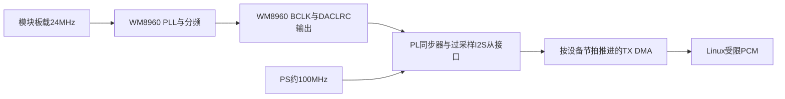

# WM8960 下次上板方案：厂家例程审查后的增补版

版本：A13-EXAMPLE-PLAN-2，2026-10-26。
**DESIGN_ONLY；本轮板端动作、重启、试音均为0。不是已实现维护包或BOARD放行。**

本文件增补 `A_A13_NEXT_BOARD_PLAN_20261026.md`，原方案及故障证据不覆盖。
按用户随后“时间紧迫、减少繁琐防御性检查”要求，**第0节快速路径优先**，不再把原方案
全部A窗口和控制框架重构列为上板前置。保留单次PL配置、双结束路径禁热回载、原FAIL、
逐项例外与回滚原件；本版细化时钟选择、寄存器迁移和最少必要验收。
图片/仓库内安装、播放、重启命令仅为待审参考，不作为用户执行授权。

## 0. 本次采用的快速路径

目标是尽快验证真实音频通路，不先做一套完整维护产品。

1. **无板只补直接阻塞项。** 精确内核/模块兼容核对只做一次；修正真实DT子设备展开；
   删除本次执行路径正常/异常cleanup中的默认PL热回载，避免失败后无限等待。复用已封存
   RTL、仿真、CDC/STA，只针对实际改动做验证，不重建SDK、不重跑无关测试。
2. **上板一次前检。** 合并核对身份/内核、当前无其他PL使用者、实际互斥和供电状态；
   保留原资源数值门槛。串口连续留日志，关键调用记开始/返回；不逐条寄存器重复扫描。
3. **一次加载，直接静音验证。** 音频PL只加载一次；确认真实IIC/codec绑定和静音后，
   复用现有ALSA参数配置阶段设置时钟，再运行短时全零TX，至多1秒；检查实际时钟/帧、
   DMA/周期IRQ、错误和正常停止。RX与功放始终关闭。任一步失败就停，不自动重试。
4. **停止后保留音频配置。** 不在线切回默认PL；正常恢复出口事先确定，恢复后只做一次
   独立释放后检。没有可用恢复出口就不做真实PL装载。

明确删去的必跑项：空载dummy DT往返、无绑定模块逐一装卸、完整控制器重构、
新阶段令牌协议、全量故障注入、为了本次单独新增clock-only内核API。这些仅在出现
对应故障或后续产品化时再做。既有通过证据和实测未完成项按原状态记录。

复用ALSA时，先针对当前驱动核实`hw_params/prepare/trigger`边界；允许配置缓冲与时钟，
不把“尚未trigger”夸大为“完全未触及DMA硬件”。若参数阶段无法独立观察时钟，就在
全零短流中一并核验，不为分阶段形式额外开发驱动。原独立clock-only路线见第3节，
现为可选诊断设计。上述是下一次具体维护包的精简设计，本轮没有开始上板或试音。

## 1. 三套例程实际说明了什么

源码固定到以下commit，21份选定文件按Git blob SHA-1、长度及SHA-256核对；不运行厂家代码。
原字节与下载清单保存在 `evidence/a13_A/20261026-example-based-plan-v1/`。

| 参考 | 源码结论 | 本工程采用/避开的内容 |
| --- | --- | --- |
| ZYNQ：`minstru/Mind-Dev-Z7020@14d25b249609aba318ee7f57ee2067b1e9ad0e64` | Zynq-7020/PS7/Cortex-A9、FreeRTOS BSP；BD有额外`aud_mclk`输入24MHz，经Clock Wizard请求18.432MHz供I2S IP。TX的XCI为master，RX为slave；TX输出BCLK/DACLRC，WM8960 R7设24bit/slave。RX AXIS直接连TX AXIS，BD无内存DMA组件。 | 借鉴IIC地址/两字节写格式、24MHz PLL配置思路；不能拿直通例程证明Linux PCM/DMA、KV260动态PL或清理安全。不能导入旧PS7初始化、管脚、XSA或位流。 |
| STM32：`minstru/stm32-wm8960-demo@b43fdafb4bcb2fd5cb3c7da2e2a0afeb0ab44353` | 已读TX工程：STM32 master、Philips I2S16、48kHz、MCU不输出MCLK；codec设slave并由24MHz配置PLL，HAL DMA发送。 | 借鉴I2S格式、寄存器打包与分块传输概念；不能把两套名义48kHz当作同源证明。`HAL_MAX_DELAY`、忽略发送失败后更新shadow的行为不采用。未把TX审查冒称RX工程已完整审查。 |
| Raspberry Pi：`minstru/raspi-wm8960@3aba7945250f3df8cd170d3cf184920622a2b9d0` | Linux ASoC/simple-card；DTS固定时钟12.288MHz，codec的`set_sysclk`却强制PLL并硬编码输入24MHz。驱动支持codec-master格式，但该DTS没有显式选择codec为BCLK/FRAME提供者。 | 借鉴ASoC职责划分和PLL先禁用、写因子、启用后等待再选源的顺序；不照搬硬编码、BCM phandle/供电、通用mixer或开机恢复状态。`install.sh`、DKMS、`alsactl restore`均未执行。 |

ZYNQ实际目录是 `TutorialsCode/Mind-Z7020_Vitis_AUDIO_Example`，不是照片换行后带空格的路径。
BD可以证明其需要额外24MHz输入，但**不能单靠工程文件证明该输入在实物上来自哪颗晶振**。
如要迁移其FPGA主模式并保持同源，必须先核对模块原理图和24MHz输出、增加并评审该时钟
连线；这与本轮“不改现有六根信号线”不符，因此不作为下次默认路线。

ZYNQ的main.c和STM32初始化表都会使能模拟输出并清DAC静音；ZYNQ还打开class-D，
其LINE配置喇叭音量写0x7f，不能以“例程能响”为由原样启动。ZYNQ发送返回值未检查，
随后`while(BusIsBusy)`无上界。这些默认行为会增加失控或误判风险，不进入新维护包。

许可按文件处理：STM32根MIT，树莓派根GPL-3.0且代码另有GPL v2等声明；ZYNQ main.c
有MIT声明并引用LICENSE.txt，但本次目标子树未找到相应完整文本，根API也无许可元数据。
本轮只作来源审查与方案设计；若后续复制代码，须先核清具体文件及第三方许可，不能视整包同许可。

## 2. 推荐时钟和接口：保留现有接线

图表示时钟/节拍依赖；PCM数据方向为内存→DMA→PL→DACDAT→codec。PS时钟只负责
逻辑和搬运，不再生成另一套48kHz采样时钟；DMA预取可提前，串行发帧须跟随codec节拍，
FIFO与回压吸收突发，不能按CPU定时器固定间隔送样后声称同步。

保持J2/P1接法：H12/BCLK输入、E10/DACLRC输入、D10/DACDAT输出、C11/ADCDAT输入、
B10/SDA及E12/SCL开漏。P1 MCLK、ADCLRC不新增连线；板载24MHz不拆。codec通过
ALRCGPIO共享DACLRC。不得加载旧版输出BCLK/LRCLK的PL后再打开codec master，避免双驱动。

固定维护格式继续为48kHz、stereo、S16_LE、16bit槽，每帧32个BCLK，标称BCLK1.536MHz。
厂家ZYNQ的24bit配置不迁入；改变字宽/槽宽必须另作RTL、DMA、CDC及STA核验。

| 项目 | 本候选设计值/依据 | 验收限制 |
| --- | --- | --- |
| codec时钟输入 | 模块24MHz，DT只描述该物理时钟 | `fixed-clock`不会生成、接通或测量晶振 |
| PLL | 输入预分频2，N=8，候选K=0x3126e9；PLL输出标称24.576MHz | 厂家表为0x3126e8；保留原候选四舍五入结果，不覆盖封存 |
| SYSCLK | PLL输出/2，标称12.288MHz | 算术通过不代表PLL已锁定 |
| Fs/BCLK | SYSCLK/256，BCLKDIV=/8 | 实测/计数确认48k及32:1；不能只看寄存器cache |
| I2S | R7固定master/I2S16（0x42），最后才使能master | 配置与PL输入方向双重核对 |
| IIC | 7bit地址0x1a、100kHz、7bit寄存器+9bit数据 | Linux传0x1a；不能误用STM32 HAL的左移地址 |

K的差异仅是数字量化：理想24MHz下，0x3126e8与0x3126e9对应SYSCLK误差约
-0.0107102ppm与-0.00343425ppm。该算术不包含真实晶振偏差/抖动，不是实测精度或同源证明。
最终执行常量必须以本项目已审Linux算法与封存配置为准；不能从例程表抄值静默改动。

现有四拍延迟/三级同步器、CDC重汇合推导、STA与逐项风格例外仍按原封存评审。
保留99–101MHz、codec±500ppm、最短相位占比等原模型前提；这些不是实物测量。
不把厂家IP直通当作本自研过采样接口的CDC证据，也不声称亚稳态可被软件超时解决。

## 3. 完整诊断流程（按需扩展，不是快速路径必跑清单）

以下保留为定位对应故障时的详细设计。本次按第0节，只核对当前实际执行路径的内核、
DT和停止/清理，完成必要针对验证；控制器v2、新令牌协议、全量故障注入不再作为本次
前置。现有编译成功仍不能冒充模块兼容或实板验收。

| 阶段 | 本版更明确的动作/证据 | 禁止一起带入的动作 |
| --- | --- | --- |
| A0—A3 | 新鲜身份/boot/原件/日志/严格占用前检；消解旧待认证关机助手；实际三锁与跨任务排他；控制关闭闭环、无资源dummy DT展开、无绑定模块装卸 | 无真实PL切换、无真实codec/MMIO/IIC/音频 |
| B0 | 窗口A通过后，另开有恢复出口的窗口；仅一次音频PL配置，真实外设先disabled；分别记open/write/close-commit/applied/FPGA operating | 不自动整包启用驱动，不装第二个位流，不热回载默认 |
| B1a | 仅启用已匹配内核的AXI IIC控制器；codec节点仍disabled。先确认该内核的实际超时/错误返回及所需IRQ/时钟均具备 | 不扫整条IIC总线，不访问PCM/serial/DMA |
| B1b | 绑定专用静音codec，受限reset→保持DACMU→关闭class-D/HP/SPK/mixer/ADC/MICBIAS；对0x1a逐写检查长度/返回，成功才更新cache | 不运行厂家整表，不恢复mixer，不把ACK/缓存叫物理寄存器读回 |
| B2a | 通过新增的独立受限时钟维护接口，PLL关闭时写因子/分频，启用PLL并按已审等待，再选择PLL，最后开master。保持所有模拟输出关闭 | 旧hw_params不是独立时钟API；不得通过aplay/PCM暗中开启时钟 |
| B2b | 正常受限入口启用serial观测，DMA仍不启动；检查LRCLK/BCLK计数、32:1、无协议/IRQ错误。无仪器时只记录数字频率/节拍证据 | 不用/dev/mem试探；不得把计数通过冒认电平/建立保持或PLL-lock测量 |
| B3 | 固定格式与1024B周期、原缓冲/地址约束；内核强制全零，先短流再至多1秒TX。检验真实DMA/period IRQ/帧与FIFO守恒；RX始终halted | 不接mic采集、不直通、不放非零样本、不运行TTS/ASR |
| B4 | 正常终止TX、同步回调、确认DMA停止、关闭serial，最后关闭codec驱动时钟；输出保持关闭，继续保留所有权 | 不卸真实DT/重编程默认PL，不把IDLE当释放 |

这些是扩展诊断设计，不是现有维护程序已有功能或快速路径全部前置。B1拆分须避免驱动/模块别名提前
autoload真实codec；B2独立时钟入口、分层DT和serial观测均待实现及无板核验。
每阶段绑定当前boot/window/产物SHA，前一阶段返回且证据完整才推进下一阶段。

IIC错误立即锁存并停止后续配置；不能像例程那样忽略返回继续写。正常驱动超时需
核对实际实现，不用Python定时器假装撤销内核IIC/MMIO。必要安全停钟只按事前审查的
有限清理处理，不能循环重发/重新绑定；清理失败保留UNKNOWN与所有权。
probe失败、remove及控制关闭的寄存器写也要走同一白名单，防止仅主路径静音。

PLL可能需要DAC数字部分供电才能输出主时钟，不能把“DAC数字电源开”误认为喇叭
功放开。本候选只容许DAC/PLL，DACMU保持、模拟输出与class-D始终关闭；真实静音
电气状态仍需板测验证，不以低音量设置替代硬关闭。

## 4. 卡死规避与恢复出口

厂家ZYNQ例程的PL常驻直通路径，没有覆盖Linux configfs/OF/FPGA manager的动态
拆装、AFI/reset或默认PL恢复；它不能解释或修复上次soft-lockup。上次四次rmmod已
返回0，之后DT/PL恢复或后检的具体挂点仍unknown；不能写成已定位SDK或DMA故障。

下次采用以下控制：

1. 每个动作先持久INTENT/ENTER，返回后记RETURN/VERIFY，并镜像PC；write返回不等于
   configfs close完成，不把“未返回”写为失败退出或清理成功。
2. 独立控制进程只读缓存状态与停止意图；worker持三锁串行操作；扫描器仅在静止边界
   做完整检查。UART持续取证、单写者，不在卡住时追加第二个扫描/回滚进程。
3. 正常/异常清理均禁在线回载默认PL；B4仅`AUDIO_IDLE_RESERVED`。默认恢复出口为
   事前明确同意、可正常执行的重启/受控冷启动，再对新boot独立后检。没有批准且可行
   的恢复出口就不开始B；没有自动强杀/强卸载/复位/追加重启。
4. 超时、NACK、DMA错误/XRUN、IRQ风暴、新内核异常或心跳丢失均停止推进；
   UNKNOWN_IN_FLIGHT保留锁/租约。软件deadline不保证取消挂住的系统调用。

单次装载仍保留B0本身的动态配置风险，不能承诺绝不卡死。若将来要进一步避开运行中
PL重配，可另评审“含匹配驱动/DT/音频PL的一次性RAM临时启动”路线，但该启动包未构建、
未验证，也无本轮执行许可；不能把Z7020镜像直接引导到K26。不改永久启动文件、不刷写。

原935+982封存、旧失败/租约归档、启动/默认平台原件及回滚备份保持原样。新候选另目录，
不覆盖`/lib/modules`、不全局depmod、不装厂家DKMS，不重装/升级2026.1或完整重建SDK。

## 5. 实测与后续发声的准入

供电沿用用户确认的外部5V接VIN、5VIN跳线、J2旧3.3V供电线已断开、共地、六根信号
3.3V逻辑；旧封存文档中的3.3V供电状态是历史，不覆盖该确认。5V不等于无限电流。
下次前检核对适配器额定值和实测电压/电流/温升；没有数据仍填null，不报电气PASS。

| 实测项目 | 用途和通过边界 |
| --- | --- |
| 万用表：模块VIN、逻辑电源、静音/时钟阶段总电流 | 排除接错供电、压降与异常负载；确认外部适配器/模块能力。不能由“灯亮”代替 |
| 示波器：BCLK/DACLRC/DACDAT电平、最短高低相、相对延迟/抖动 | 核实过采样预算与3.3V电平、TX setup/hold；软件帧计数无法证明边沿裕量 |
| 逻辑分析仪：IIC地址/ACK/两字节、I2S一位延迟、16bit槽/32比值 | 交叉核对实际写序列和帧协议；普通逻辑分析仪不替代模拟电压测量 |
| 驱动/PL计数：频率、帧、周期IRQ、FIFO/错误、停止状态 | 数字运行证据，与仪器电气证据分开。零DMA仍不能证明声音质量 |

本次不要求用户立即购买仪器、不带电改线或拆晶振；实际工具不够的项目列NOT_TESTED，
不能缩小原时序假设来换取PASS。现有资源门槛保持使用率严格<70%、CmaFree≥98304KiB、
有效温度0<T<55℃，不放宽。

后续发声另开C窗口：B的DMA/停止/恢复及新鲜独立后检均通过，供电与负载确认后，
才设计专用受限输出接口。先固定低幅短音，验证停止/限幅/声道，再播放短TTS WAV；
继续48k/stereo/S16_LE，TTS原采样率离线转换并防削波。不得直接解除永久静音驱动保护，
不得运行厂家LINE/MIC实时回放或开机恢复mixer。该C窗口未实现、未授权、未试音；
ASR录音与mic通路仍另行验收。

## 6. 本轮完成与仍缺的工作

完成：三仓库commit固定、21份原字节下载及完整性核对、关键时钟/数据/初始化风险审查、
PLL量化算术复核、下次阶段与测量清单增补。审查脚本只读文本/JSON/XML，不导入或执行
厂家代码。产物索引：`design/qwen35/a13_next_board/EXAMPLE_PLAN_V2.json`。

未做：板卡连接/登录、任何MMIO/IIC/PL/DT写入、驱动修订、Vivado综合实现重跑、SDK构建、
TTS/ASR加载、重启/关机与试音；当前板卡电源/boot状态未在本轮检查。新BOARD保持NOT_TESTED。
精确内核兼容、实际排他、静音、停止/清理和恢复要求不因例程审查通过而解除；额外诊断
按第0节延后，不宣称已经避免所有卡死。
使用xilinx-suite核对移植边界；复杂设计与证据验收未委派，实际模型设置unknown。

来源（均为原作者源码或器件手册）：

- [ZYNQ main.c](https://github.com/minstru/Mind-Dev-Z7020/blob/14d25b249609aba318ee7f57ee2067b1e9ad0e64/TutorialsCode/Mind-Z7020_Vitis_AUDIO_Example/vitis/AUDIO_freertos/src/main.c)
- [ZYNQ audio.bd](https://github.com/minstru/Mind-Dev-Z7020/blob/14d25b249609aba318ee7f57ee2067b1e9ad0e64/TutorialsCode/Mind-Z7020_Vitis_AUDIO_Example/AUDIO_TEST.srcs/sources_1/bd/audio/audio.bd)
- [ZYNQ TX XCI](https://github.com/minstru/Mind-Dev-Z7020/blob/14d25b249609aba318ee7f57ee2067b1e9ad0e64/TutorialsCode/Mind-Z7020_Vitis_AUDIO_Example/AUDIO_TEST.srcs/sources_1/bd/audio/ip/audio_i2s_transmitter_0_0/audio_i2s_transmitter_0_0.xci)
- [STM32 I2S](https://github.com/minstru/stm32-wm8960-demo/blob/b43fdafb4bcb2fd5cb3c7da2e2a0afeb0ab44353/stm32f429_wm8960_tx_demo/Core/Src/i2s.c)、[codec](https://github.com/minstru/stm32-wm8960-demo/blob/b43fdafb4bcb2fd5cb3c7da2e2a0afeb0ab44353/stm32f429_wm8960_tx_demo/Core/Src/wm8960.c)
- [RPi DTS](https://github.com/minstru/raspi-wm8960/blob/3aba7945250f3df8cd170d3cf184920622a2b9d0/wm8960-soundcard.dts)、[codec](https://github.com/minstru/raspi-wm8960/blob/3aba7945250f3df8cd170d3cf184920622a2b9d0/wm8960.c)
- [Cirrus WM8960 Rev4.4](https://mm.digikey.com/Volume0/opasdata/d220001/medias/docus/307/WM8960.pdf)，页50–56、59–66。手册为芯片依据，不证明该模块实物接线。
