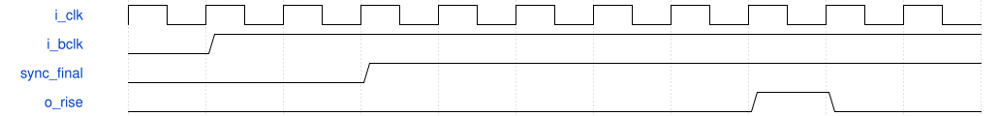

# audio_input_sampler 模块规范

> RTL: `rtl/audio_input_sampler.v`

## 1. 模块目的

未提供模块目的。

## 2. 参数

| 参数 | 默认值 | 说明 |
| --- | --- | --- |
| — | — | 本模块没有可配置参数。 |

## 3. 时钟与复位

- 时钟：`{"name": "i_clk", "edge": "posedge", "nominal_hz": 99999001}`
- 复位：`{"name": "i_rstn", "active_level": 0, "type": "asynchronous_assert_synchronous_release_by_proc_sys_reset"}`

## 4. 接口信号规范

| 信号 | 方向 | 位宽 | 时钟域 | 语义角色 | 描述 |
| --- | --- | --- | --- | --- | --- |
| `i_clk` | input | 1 | i_clk | PS输出的唯一过采样时钟 | PS输出的唯一过采样时钟 |
| `i_rstn` | input | 1 | i_clk | 专用复位器输出 | 专用复位器输出 |
| `i_bclk` | input | 1 | external_async | H12上的异步位时钟电平，仅作为数据 | H12上的异步位时钟电平，仅作为数据 |
| `i_lrclk` | input | 1 | external_async | E10上的异步左右标记 | E10上的异步左右标记 |
| `i_adcdat` | input | 1 | external_async | C11上的异步录音位 | C11上的异步录音位 |
| `o_rise` | output | 1 | i_clk | 延迟上升事件 | 延迟上升事件 |
| `o_fall` | output | 1 | i_clk | 延迟下降事件 | 延迟下降事件 |
| `o_channel` | output | 1 | i_clk | 已稳定的声道电平 | 已稳定的声道电平 |
| `o_sample` | output | 1 | i_clk | 已稳定的ADC位 | 已稳定的ADC位 |

## 5. 周期行为与延迟

- 三个独立三级ASYNC_REG链，BCLK额外延迟四拍后产生注册边沿。
- LR和ADC先稳定，再由串行引擎在延迟事件消费；不使用BCLK驱动PL时钟网络。

## 6. WaveDrom 时序图

### 已确认接口的示意时序（不是实测波形）

波形是合同示意；实际仿真必须另读xsim日志。

- WaveJSON：[audio_input_sampler_i2s-boundary.json5](waveforms/audio_input_sampler_i2s-boundary.json5)

## 7. 边界、反压与错误

- 上电或重新使能处于半帧时，必须等真实左起点。
- 失钟/欠载/阻塞/错误槽宽或包尾需要STOP和显式确认后恢复。

## 8. CDC 与综合约束

- Verilog-2001；单系统时钟，固定16位槽、48kHz双声道。
- 时钟/数据入口与片外建立保持采用独立预算；亚稳态不能由RTL仿真证明消失。

## 9. 验证与验收

- 独立帧模型；异步相位、40%-60%占空、左右LSB跨界。
- xsim正常520帧与五类故障；周期和输入偏斜扫查，综合/实现/CDC/STA单独列证据。

## 10. 可追溯性

- 规格模块：`audio_input_sampler`
- RTL 路径：`rtl/audio_input_sampler.v`
- 交付要求：本文档、WaveJSON 和 SVG 必须与同一版本规格一同发布。
