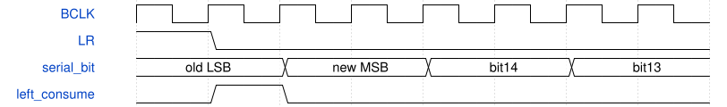

# audio_serial_slave 模块规范

> RTL: `rtl/audio_serial_slave.v`

## 1. 模块目的

未提供模块目的。

## 2. 参数

| 参数 | 默认值 | 说明 |
| --- | --- | --- |
| — | — | 本模块没有可配置参数。 |

## 3. 时钟与复位

- 时钟：`{"name": "i_clk", "edge": "posedge", "nominal_hz": 99999001}`
- 复位：`{"name": "i_rstn", "active_level": 0, "type": "asynchronous_assert_synchronous_release_by_proc_sys_reset"}`

## 4. 接口信号规范

| 信号 | 方向 | 位宽 | 时钟域 | 语义角色 | 描述 |
| --- | --- | --- | --- | --- | --- |
| `i_clk` | input | 1 | i_clk | 与AXI相同的系统时钟 | 与AXI相同的系统时钟 |
| `i_rstn` | input | 1 | i_clk | 专用低有效复位 | 专用低有效复位 |
| `i_rise` | input | 1 | i_clk | 已同步的上升事件 | 已同步的上升事件 |
| `i_fall` | input | 1 | i_clk | 已同步的下降事件 | 已同步的下降事件 |
| `i_channel` | input | 1 | i_clk | 稳定LR | 稳定LR |
| `i_sample` | input | 1 | i_clk | 稳定ADC位 | 稳定ADC位 |
| `i_control` | input | 32 | i_clk | 位0播放、位1采集、位2仅停机时确认错误 | 位0播放、位1采集、位2仅停机时确认错误 |
| `i_s_axis_tdata` | input | 32 | i_clk | 播放L低16/R高16 | 播放L低16/R高16 |
| `i_s_axis_tlast` | input | 1 | i_clk | 发送第256帧包尾 | 发送第256帧包尾 |
| `i_s_axis_tvalid` | input | 1 | i_clk | 播放负载所有权 | 播放负载所有权 |
| `o_s_axis_tready` | output | 1 | i_clk | 注册预取许可 | 注册预取许可 |
| `o_m_axis_tdata` | output | 32 | i_clk | 录音L低16/R高16 | 录音L低16/R高16 |
| `o_m_axis_tlast` | output | 1 | i_clk | 保持型录音包尾 | 保持型录音包尾 |
| `o_m_axis_tvalid` | output | 1 | i_clk | 保持型录音所有权 | 保持型录音所有权 |
| `i_m_axis_tready` | input | 1 | i_clk | 内存接收许可 | 内存接收许可 |
| `o_dacdat` | output | 1 | i_clk | D10唯一数字输出 | D10唯一数字输出 |
| `o_status` | output | 32 | i_clk | 0xa13c签名与锁存诊断 | 0xa13c签名与锁存诊断 |
| `o_irq` | output | 1 | i_clk | 错误保持型中断 | 错误保持型中断 |

## 5. 周期行为与延迟

- 固定I2S一位延迟，边界上升采旧字LSB；下降事件寄存译码后装下一字。
- 所有控制、状态、弹性缓冲和DMA流均属于i_clk，无独立48k采样发生器。
- TX缓存仅一帧；RX在空间不足时锁存错误，不覆盖旧负载。
- 注册指令增加系统拍延迟，器件端采样率仍由WM8960决定。
- 错误位0失钟、1槽宽、2欠载、3溢出、4包尾；位6播放对齐、7帧锁定。

## 6. WaveDrom 时序图

### 已确认接口的示意时序（不是实测波形）

波形是合同示意；实际仿真必须另读xsim日志。

- WaveJSON：[audio_serial_slave_i2s-boundary.json5](waveforms/audio_serial_slave_i2s-boundary.json5)

## 7. 边界、反压与错误

- 上电或重新使能处于半帧时，必须等真实左起点。
- 失钟/欠载/阻塞/错误槽宽或包尾需要STOP和显式确认后恢复。

## 8. CDC 与综合约束

- Verilog-2001；单系统时钟，固定16位槽、48kHz双声道。
- 时钟/数据入口与片外建立保持采用独立预算；亚稳态不能由RTL仿真证明消失。

## 9. 验证与验收

- 独立帧模型；异步相位、40%-60%占空、左右LSB跨界。
- xsim正常520帧与五类故障；周期和输入偏斜扫查，综合/实现/CDC/STA单独列证据。

## 10. 可追溯性

- 规格模块：`audio_serial_slave`
- RTL 路径：`rtl/audio_serial_slave.v`
- 交付要求：本文档、WaveJSON 和 SVG 必须与同一版本规格一同发布。
