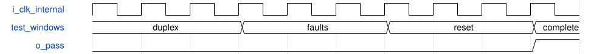

# tb_audio_serial_slave 模块规范

> RTL: `tb/tb_audio_serial_slave.v`

## 1. 模块目的

未提供模块目的。

## 2. 参数

| 参数 | 默认值 | 说明 |
| --- | --- | --- |
| — | — | 本模块没有可配置参数。 |

## 3. 时钟与复位

- 时钟：`{"name": "i_clk", "edge": "posedge", "nominal_hz": 100000000}`
- 复位：`{"name": "i_rstn", "active_level": 0, "type": "testbench_internal_async_assert"}`

## 4. 接口信号规范

| 信号 | 方向 | 位宽 | 时钟域 | 语义角色 | 描述 |
| --- | --- | --- | --- | --- | --- |
| `o_pass` | output | 1 | i_clk | 所有自检完成后才拉高 | 所有自检完成后才拉高 |

## 5. 周期行为与延迟

- 内部10ns系统时钟，独立codec位流与DMA源汇，不读DUT移位寄存器求golden。
- 1024帧向量由独立Python模型生成；520帧双向比较及两次256帧TLAST。
- 五类故障另测：失钟、错误槽宽、欠载、溢出和错误包尾。
- 额外覆盖运行中拒绝清错、非零负载回压保持、半帧启动、单向槽宽监视、复位隔离。
- 648..652ns周期和10..30ns LR偏斜为数字压力，不代表振荡器实测或亚稳态模拟。

## 6. WaveDrom 时序图

### 已确认接口的示意时序（不是实测波形）

波形是合同示意；实际仿真必须另读xsim日志。

- WaveJSON：[tb_audio_serial_slave_i2s-boundary.json5](waveforms/tb_audio_serial_slave_i2s-boundary.json5)

## 7. 边界、反压与错误

- 上电或重新使能处于半帧时，必须等真实左起点。
- 失钟/欠载/阻塞/错误槽宽或包尾需要STOP和显式确认后恢复。

## 8. CDC 与综合约束

- 仅验证，含延时和task，不用于综合或板端部署。
- 仿真不能模拟模拟亚稳态或证明MTBF。

## 9. 验证与验收

- 独立帧模型；异步相位、40%-60%占空、左右LSB跨界。
- xsim正常520帧与五类故障；周期和输入偏斜扫查，综合/实现/CDC/STA单独列证据。

## 10. 可追溯性

- 规格模块：`tb_audio_serial_slave`
- RTL 路径：`tb/tb_audio_serial_slave.v`
- 交付要求：本文档、WaveJSON 和 SVG 必须与同一版本规格一同发布。
