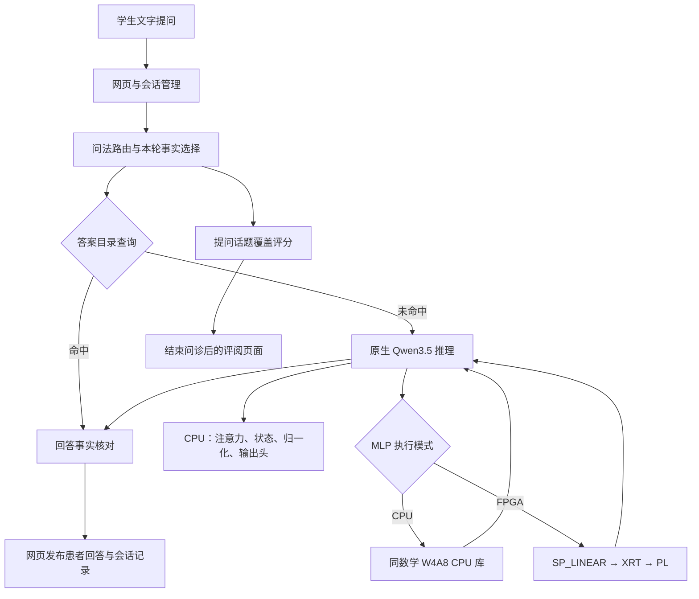

# KV260 Qwen3.5 问诊系统工程总结（无语音版）

整理日期：2026年10月28日，北京时间。

本工程在 KV260 上实现了基于 Qwen3.5-0.8B 的文字模拟问诊系统，形成了病例管理、患者短答、CPU/FPGA 推理、答案缓存、会话控制和问诊评分的完整交互流程。模型的24层 MLP 共72个线性投影已接入 PL，逐层计算结果进入后续模型计算；网页端支持20例合成胸痛病例、随机分配、连续提问、取消和结束评阅。

本文以10月27日上板、10月28日调度对比后恢复的二十例缓存调试版为对象，结合当前工程、远端仓库、冻结运行包及原始实测记录整理。范围为文字问诊及计算系统。最近一次板端状态是10月28日按用户要求正常关机。

## 1. 版本与运行基线

| 项目 | 本版采用内容 |
| --- | --- |
| 硬件平台 | AMD KV260 / K26，Arm Cortex-A53 与 PL 协同计算 |
| 板端模型 | Qwen/Qwen3.5-0.8B，文本、非思考模式，greedy 生成 |
| 模型 revision | 2fc06364715b967f1860aea9cf38778875588b17 |
| 运行时基础 | llama.cpp，commit 81e39ad34368329b5db77620721510fd91107e80；叠加本工程的图接入与状态管理修改 |
| 模型文件 | qwen35-text-Q4_K_M.gguf，529,297,376 B，约504.78 MiB |
| MLP 权重 | 从原始 BF16 权重导出的 W4A8 sidecar，72个矩阵 |
| 计算核 | B 来源 e227297ee1bb0bdf542fc81761642b23639e15c0，double 方案，build ID 0xB3030002 |
| 工具链与平台 | Vivado / Vitis / HLS 2026.1，官方 kv260_base |
| 实测系统环境 | Linux 6.8.12-a10irq2，XRT 2.18.0 |
| 模型运行配置 | 上下文1024 token，输出上限32 token，主推理线程4，同数学 CPU 计算库线程4，物理微批上限8 |
| 应用内容 | 20例合成胸痛病例、60条开场主诉、1320条模型答案目录 |
| 当前调度选择 | nice 调整量0 |
| 本地运行包 | [二十例缓存调试版](工程/backups/a12_no_voice_baseline_20261028_v1/factory/) |
| 方案备份 | [无语音基线备份](工程/backups/a12_no_voice_baseline_20261028_v1/) |
| 最后恢复运行目录 | /var/lib/kv260-a12/case20-debug-permission-restore-20261028-v1 |

远端仓库为 [patient-FPGA](https://github.com/4hydrofuran/patient-FPGA)。本次核对时，最新二十例前端分支为 [codex/case20-frontend-updates-20261028](https://github.com/4hydrofuran/patient-FPGA/tree/codex/case20-frontend-updates-20261028)，提交为 [d8183a25366e3905d88c2dad21d54eb640025ec2](https://github.com/4hydrofuran/patient-FPGA/commit/d8183a25366e3905d88c2dad21d54eb640025ec2)。病例清单、患者短句策略、答案缓存实现及最新网关引擎均与该提交对应文件逐字节一致。

运行包源清单 SHA256 为 b92739af07cde88831cef5435ba0ab1693bdb7a61e3cfafdf829e610b939b1f2。备份中的工厂包包含1926项清单文件，91,518,795 B；本次整理逐项复核了大小与 SHA256。

## 2. 系统结构

系统由浏览器交互层、问诊业务层、模型运行层和 FPGA 计算层组成。

| 层次 | 主要职责 |
| --- | --- |
| 浏览器与网关 | 随机开始问诊、输入问题、展示回答、CPU/FPGA 模式选择、取消、刷新恢复、结束评阅 |
| 病例与会话 | 加载病例事实，绑定当前病例和请求，保留已发布内容，管理场次生命周期 |
| 问法规划与核对 | 识别支持的话题，选择一至两个相关事实，生成短答输入，核对事实、数字、单位和否定关系 |
| 模型运行时 | 分词、公共前缀恢复、prefill、decode、EOS 判断和混合状态管理 |
| 线性计算后端 | 通过统一 C 接口选择同数学 CPU 计算或 XRT/PL 计算 |
| 评分与评阅 | 按学生提问统计话题覆盖，关联原始提问，生成覆盖项、遗漏项和复核项 |

最新网关位于 [B_601e69ca_A_case20_debug_20261027 派生工程](工程/platform/qwen35/web/integrated/B_601e69ca_A_case20_debug_20261027/web_gateway/)。模型接入与运行控制集中在 [runtime/qwen35_w4a8](工程/runtime/qwen35_w4a8/) 和 [platform/qwen35/a12](工程/platform/qwen35/a12/)。

## 3. 病例、患者回答与问诊评分

### 3.1 病例组织

当前病例库包含 SYN_CP_01 至 SYN_CP_20，共20例合成胸痛病例。每例使用11类结构化事实：疼痛部位、性质、起病时间、持续时间、程度、放射部位、诱因、缓解因素、呼吸困难、过敏史和用药史。事实同时记录已知或未知状态、单位、时间范围及肯定或否定关系。

病例清单按以下场景组织：

| 场景分组 | 例数 |
| --- | ---: |
| 活动相关 | 6 |
| 动作相关 | 4 |
| 进食体位相关 | 4 |
| 呼吸相关 | 3 |
| 紧张相关 | 1 |
| 信息不完整 | 1 |
| 静息相关 | 1 |
| 合计 | 20 |

每例提供3条开场主诉，共60条不同表述。开场文字由病例资料按会话选取；学生开始问诊后，服务端随机分配病例。刷新和相同请求重试继续使用当前场次，结束后通过“新病例”进入下一场。

### 3.2 患者短答生成

问法路由采用明确的词法规则，将当前问题映射到病例事实。每轮选取一至两个相关事实，使用患者口语表达构造短提示，再交给目标模型生成回答。例如，持续时间可以表达为“一回大约疼 20 分钟。”，疼痛程度可以表达为“满分 10 分的话我有 5 分。”。

模型输入由中性系统提示和本轮事实句组成。事实表达按事实内容稳定选择，回答经检查器核对后发布。检查内容包括所问事实是否完整、是否引入额外事实，以及数字、单位、否定和时间范围是否一致。未识别的问题进入澄清流程，受限问题进入相应策略回复。

这种分工把问法识别、事实选择、语言输出和回答核对分别落实到可检查的处理步骤，围绕胸痛病例的11类结构化事实组织患者口语短答。

### 3.3 评分与评阅

评分采用10个问诊话题、每项10分的覆盖量表，总分100分。计分话题为疼痛部位、性质、起病时间、持续时间、程度、放射部位、诱因、缓解因素、呼吸困难和过敏史。用药史作为可回答事实保存。

计分依据是已接收并成功识别的学生提问，同一话题重复询问累计覆盖一次。每项得分关联原始问题及轮次；含义需要复核的提问单独列出。结束问诊时冻结本场记录，再由规则生成评阅文字、已覆盖话题、遗漏话题和下一次练习建议。

网页通过“评阅意见”“评分依据”“待复核”“问诊记录”展示结果。当前量表版本为 coverage-v1-draft，教师审核状态保存在结果中，评价内容为问诊话题覆盖。

## 4. 模型接入与 W4A8 计算

### 4.1 计算范围

Qwen3.5-0.8B 的24层中，18层线性注意力和6层完整注意力保持 CPU 路径。每层 MLP 的 gate、up、down 三个投影接入统一线性计算后端，共72个目标矩阵。

| 投影 | 输出维度 N | 输入维度 K | 数量 |
| --- | ---: | ---: | ---: |
| gate | 3584 | 1024 | 24 |
| up | 3584 | 1024 | 24 |
| down | 1024 | 3584 | 24 |

CPU 继续执行注意力、Gated DeltaNet、卷积状态更新、归一化、SiLU、门控乘法、残差和输出头。gate/up 使用相同输入激活，down 对门控后的真实激活单独量化。模型图中的自定义算子在执行时读取激活，并将后端返回值交给后续消费者。

模型文件提供模型元数据及非目标权重；72个目标 MLP 权重采用从原始 BF16 导出的独立 sidecar。该组织使同数学 CPU 与 PL 使用同一套目标权重和量化定义。

### 4.2 数值规则

公共数学契约为 SP_W4A8_128x32_V1。

| 项目 | 采用规则 |
| --- | --- |
| 权重 | 有符号4 bit，数值范围 −7 至7 |
| 激活 | 有符号8 bit，数值范围 −127 至127 |
| 权重分组 | 沿 K 维每128项一组 |
| 输出分块 | 沿 N 维每32个输出通道一块 |
| 激活 scale | 按 token 对有效 K 范围计算 absmax/127 |
| 舍入 | nearest ties to even |
| 组内累加 | INT32 |
| scale 与输出 | FP32 |
| 全零组 scale | 1.0 |

每个分组先完成整数点积，再依次执行 FP32 的“整数和乘权重 scale、再乘激活 scale”，最后按分组顺序累加。CPU 参考与硬件遵循相同的计算顺序。

公共 C 接口 SP_LINEAR_V1 提供 open、load、run、report、unload、close 六个操作。软件层支持 T=1至8，模型物理微批上限为8，decode 使用单 token 路径。prefill 按微批推进，尾块按实际 token 数计算。

规范入口为 [量化契约](工程/contracts/qwen35/quant_v1.json) 与 [C ABI 头文件](工程/contracts/qwen35/sp_linear_v1.h)。

## 5. FPGA、XRT 与板端平台

### 5.1 计算核与实现结果

计算核采用已接收的 double 方案，32个输出通道并行，K 维顺序处理，使用两个权重组缓冲配合加载和计算，并在同一批 token 间复用权重。每个权重组2176 B，双组缓冲共4352 B。

核来源、源码、XO 和 build ID 由 [KERNEL_SOURCE.json](工程/hw/linear_A/KERNEL_SOURCE.json) 固定。工程完成了该核的接收检查、独立数值验证、官方平台链接和目标布局布线。

| 实现指标 | 结果 |
| --- | ---: |
| 实际核时钟 | 149.9985 MHz |
| 路由后 WNS | +0.809 ns |
| TNS | 0 |
| WHS | +0.010 ns |
| 全设计 LUT | 27,572 |
| 全设计 FF | 40,665 |
| RAMB36 / RAMB18 | 42 / 5 |
| DSP | 100 |
| URAM | 0 |
| 核层级 LUT / FF | 14,757 / 21,027 |

这些数据来自目标设计的布局布线报告。HLS 综合结果及其时序估计在原报告中单独保存。

### 5.2 XRT 运行路径

XRT 层负责设备和核对象、BO 分配、数据同步、任务提交、完成确认、metadata 检查及资源释放。运行顺序为：

1. 加载权重和 scale，建立矩阵句柄及对应 BO。
2. 对当前激活进行 A8 量化，写入并同步输入。
3. 提交带 job_id 的任务，等待完成。
4. 核对完成状态、build ID、job 回显及错误信息。
5. 同步并检查输出，将 Y 交给模型图消费者。

权重在一个运行窗口内驻留，稳态请求复用已有权重和 I/O 缓冲。24层诊断及生成窗口实际加载72份权重一次，148个显式 BO 共140,591,104 B，约134.08 MiB；其中权重及 scale 的有效数据为140,378,112 B，约133.88 MiB。

BO 的实际 group、地址范围、对齐和预算由运行时检查。板端采用低2 GiB 地址范围约束及8192 B 分配记账，I/O 缓冲复用。强制 FPGA 模式的执行错误返回上层；CPU 模式由用户显式选择。

### 5.3 平台运行与会话管理

板端使用 irq2 内核及匹配 XRT/ZOCL 路径，结合 IRQ 与引用计数修订，完成计算前平台切换、运行期管理和计算后正常释放。A10建立了向量运算及恢复闭环，A11推进到真实 MLP，A12接入完整模型。

运行管理器串行处理 PL 任务，检查设备身份、租约、锁、内核健康、温度和内存，并保存许可与完成记录。正常关闭按 worker 退出、设备映射释放、驱动卸载、默认平台恢复和租约归档的顺序执行。20例版本还提供4小时有界连续服务配置。

模型状态采用 R0 清理与已验证公共前缀恢复。换病例、新请求及取消后的处理同时管理 recurrent、conv 和 KV 状态。完成边界取消会阻止后续提交并丢弃晚到结果，后续请求使用重新建立的工作状态。

## 6. 响应时间优化

本版围绕问诊短答工作量实施了公共前缀复用、目标模型草稿核对和模型答案缓存。

### 6.1 共享公共前缀

系统预先计算34-token中性公共前缀，保留完整混合状态及末位置 logits。后续请求核验模型、运行时、模板、量化与布局身份后恢复该状态，再处理本轮新增事实。

20例共享一份公共前缀和同一模型，前缀保留数据为21,614,659 B，约20.61 MiB。病例内容及事实变化进入各自的本轮输入。

### 6.2 目标模型核对草稿

事实短句可以形成候选 token 序列。原生运行时使用目标模型核对 greedy token 和 EOS；候选一致时使用该次模型结果，出现分歧时执行目标模型完整生成。

1320条答案生成记录中，1232条接受草稿，其余完成目标模型重放和结果核对。这项机制用于减少逐 token 往返次数，答案来源保留目标模型的生成记录。

### 6.3 模型答案缓存

缓存按病例编号、版本及内容、当前所问事实、模型与运行时身份、提示词策略、planner 和 checker 身份精确匹配。命中后仍针对本轮计划检查回答。

11类事实的单项和两项组合共66组，20例合计1320条。全部答案由真实目标模型 CPU 路径生成，保留 EOS、输出 token、文本摘要和原始结果来源；最长回答23 token，运行上限32 token。目录文件为1,732,636 B，约1.65 MiB。

命中记录采用 MODEL_CACHE，保留原 CPU_REFERENCE 来源，本轮模型调用和 PL 提交数为0。未命中则调用当前选择的 CPU 或 FPGA 后端。界面逐条保存提问时的运行模式，并提供下一场“正常、缓存命中、缓存未命中”设置，便于观察两条执行路径。

目录 SHA256 为 b97871b7bd67252d63d4834544b323680824ce49dc4dcabc084cf124bf3ec79f。目录及来源记录见 [full1320 生成证据](工程/evidence/model_pl_A/20261027-case20-natural-v1/full1320/)。

## 7. 数值与功能验证

验证从独立参考、仿真、实现推进到真实板端，再覆盖模型图和网页交互。

| 层次 | 已完成验证 | 主要结果 |
| --- | --- | --- |
| 本地 Csim | 当前 e227297 double 核，61例、2,800,022项检查 | 两个真实尺寸 T1至8、尾块、边界及错误输入通过，受测 FP32 输出逐位一致 |
| RTL 协同仿真 | 核对同版真实尺寸 T1/T8 原始记录及归档结果 | 具备目标核的 RTL 验证材料 |
| 目标实现 | kv260_base 上硬件链接及布局布线 | 实现收敛，资源与时序见第5节 |
| A11 独立板测 | 23次有效真实调用，含手算、尾块及真实 gate/up/down | 原始 FP32 Y 与冻结参考逐字节一致 |
| A12 全模型诊断 | 24层、72投影、216份 PL 输出及其图消费者 | 同板同 ARM 的 S1/S2 投影、logits 和混合状态逐位一致 |
| A12 自然生成 | 17条模型请求、25,776次 PL 调用 | 同板 S1/S2 的 token、文本、EOS 及所检查状态指纹一致 |
| 状态与分块 | T=1/2/4/8、尾块、1024上下文、跨病例、完成边界取消 | 同 ARM 对照通过；状态测试窗口含24,192次真实 PL 调用 |
| 病例与答案 | 400条开发记录、1320条模型答案 | 预期路由及当前事实检查通过，1320条均完成 EOS |
| 应用与前端 | 二十例接入时54项相关回归，另有随机与缓存调试专项测试 | 问诊、刷新、重试、模式显示、评分和下一场设置通过 |
| 真实浏览器 | Edge 电脑端、Firefox 板端 | 完成实时回答、缓存回答和结束评阅的可见交互验证 |

S1 表示采用同一 W4A8 数学的 CPU 路径，S2 表示 MLP 使用 PL 的模型路径。两者的逐位一致结果用于核对实现一致性。

完整模型的核心证据是“计算输出进入后续模型节点”：诊断记录将真实输入、PL 输出、job_id、build ID 与 GLU/残差消费者关联，并检查最终 logits 和混合状态。自然生成另保留请求、输出和完成记录。

## 8. 实测性能与资源

### 8.1 最新板端交互

| 场景 | 样本 | 测量范围 | 实测结果 |
| --- | --- | --- | --- |
| 二十例随机版本缓存命中 | 3条 | 提问至完整回答 DOM 更新后的两次 rAF | 133、137、142 ms |
| 缓存调试版显式命中 | 1条 | 同一浏览器完整答案显示范围 | 163 ms，模型调用0 |
| 缓存调试版显式未命中 | 1条 | 同一浏览器完整答案显示范围 | 9,614 ms，实际后端 FPGA_REAL |
| 随机第18例首条 FPGA 回答 | 1条 | 网页轮询观察 / native 请求 | 13.104 s / 12.859 s |
| 最新原调度实时 FPGA 请求 | 4条 | native 请求，含前缀恢复 | 中位13.493 s，每条288次 PL 调用 |

浏览器两次 rAF 计时用于观察完整回答更新，native 计时用于分析模型请求。表内保留各自采样数量与计时起止。

### 8.2 调度方案选择

10月27日晚至28日凌晨，对“持续时间”和“疼痛程度”各重复两次，比较原调度与 nice+10。两组均旁路答案缓存，使用相同模型、提示词、输出 token、前缀及调用形状。

| 指标，4条样本中位数 | 原调度 nice0 | nice+10 |
| --- | ---: | ---: |
| 原生模型请求 | 13.493 s | 14.671 s |
| 许可往返 | 4.159 s | 5.053 s |
| 同步日志记录 | 2.223 s | 3.097 s |
| 后端计算及数据处理 | 3.805 s | 3.807 s |

nice+10 的模型请求中位耗时增加8.73%，因此本版保留原调度。同步日志记录包含编码、写入和 fsync，位于许可往返内部；分项用于定位管理路径开销。

### 8.3 电脑端配对与资源记录

二十例版本在电脑端完成25对同题同输出的真实浏览器比较：

| 指标 | 实时 CPU 模型 | 答案缓存 |
| --- | ---: | ---: |
| 完整答案绘制中位数 | 674 ms | 43.2 ms |
| 完整答案绘制最大值 | 977.4 ms | 69.4 ms |
| 测量期间模型调用 | 25 | 0 |

完整1320条模型生成记录的中位耗时为892.4 ms，最慢3,237.5 ms。以上为电脑端 CPU_REFERENCE 数据。

空间与内存按记录类型列示：

| 项目 | 数值 | 记录条件 |
| --- | ---: | --- |
| 20份病例 JSON | 59,844 B，约58.4 KiB | 本地文件 |
| 答案目录 | 1,732,636 B，约1.65 MiB | 本地及板端启用的1320条目录 |
| Python 缓存对象常驻 | 5,709,485 B，约5.45 MiB | 电脑端 Python 分配测量 |
| 单公共前缀 | 21,614,659 B，约20.61 MiB | 前缀保留数据 |
| 管理进程 RSS | 70,892 KiB | 10月27日随机病例板端窗口 |
| 模型进程 RSS | 555,196 KiB | 同一板端窗口 |
| MemAvailable | 2,285,280 KiB | 同一时刻板端观测 |
| CmaFree | 55,392 KiB | 同一时刻板端观测 |

当前交互速度来自两条路径：已有短答通过答案目录快速返回，实时请求通过常驻权重、公共前缀和目标模型核对草稿减少重复工作。最新配对数据也表明，许可管理与同步记录仍是实时 FPGA 请求的重要耗时部分。

## 9. 工程成果与报告重点

本工程已把 Qwen3.5 的选择性算子接入推进到可操作的板端问诊应用。报告可以围绕以下成果展开：

1. 完成24层 MLP 的 W4A8 CPU/PL 统一接入，保留混合注意力及状态更新的 CPU 计算路径。
2. 建立从原始权重导出、公共数学契约、独立参考、仿真、布局布线到真实模型消费者的验证链。
3. 将权重驻留、BO 复用、低地址约束、任务 metadata 和平台恢复组合为可运行的板端执行流程。
4. 完成20例胸痛病例、事实约束短答、随机问诊、可追溯话题评分和浏览器评阅。
5. 将公共前缀、目标模型核对草稿和1320条答案缓存用于短答工作量，记录各自执行来源与耗时。

报告中可采用以下概述：

> 本项目面向模拟问诊训练，在 KV260 平台上构建了基于 Qwen3.5-0.8B 的文字交互系统。系统采用 Arm 与 FPGA 协同计算，将24层 MLP 的72个线性投影接入统一 W4A8 后端，其余模型计算和混合状态管理由 CPU 执行。通过独立参考、仿真、目标实现及同板对照，验证了目标算子及完整模型路径的计算一致性。应用接入20例合成胸痛病例，支持随机问诊、患者短答、取消和问诊话题覆盖评阅，并通过共享前缀、目标模型核对草稿和答案缓存改善响应。实板缓存样本的完整回答显示时间为133至163毫秒；最新4条实时 FPGA 请求的原生耗时中位数为13.493秒。

后续报告数据可集中补充四项：固定工作量至少30次重复的时延统计、同配置2小时连续运行、直流输入边界的功率与每轮能量测量、教师对病例及问诊量表的审核。应用扩展可围绕更多主诉类别、问法覆盖和患者表达展开。

## 10. 素材与证据索引

| 报告内容 | 工程及材料入口 |
| --- | --- |
| 总体状态与最新版本 | [PROJECT_STATUS.json](工程/docs/PROJECT_STATUS.json)、[二十例前端交付说明](工程/docs/A12_CASE20_FRONTEND_DELIVERY_20261028.md) |
| 病例与应用规则 | [病例目录](工程/system_qwen35/cases/)、[问法规划](工程/system_qwen35/app/planning.py)、[评分规则](工程/system_qwen35/app/scoring.py) |
| 最新网页与评阅 | [网关源码](工程/platform/qwen35/web/integrated/B_601e69ca_A_case20_debug_20261027/web_gateway/src/patient_web/)、[评阅实现](工程/platform/qwen35/web/integrated/B_601e69ca_A_case20_debug_20261027/web_gateway/src/patient_web/evaluation.py) |
| CPU 图接入与公共接口 | [运行时说明](工程/runtime/qwen35_w4a8/README.md)、[量化契约](工程/contracts/qwen35/quant_v1.json)、[C ABI](工程/contracts/qwen35/sp_linear_v1.h) |
| 核来源、仿真与实现 | [核来源固定记录](工程/hw/linear_A/KERNEL_SOURCE.json)、[A06验收报告](工程/evidence/A06_acceptance/final-20261004-v1/REPORT.md)、[A07实现报告](工程/evidence/A07_closeout/20261004-v1/REPORT.md) |
| XRT 实现与平台 | [XRT代码](工程/modules/linear_A/xrt/)、[A10平台交付](工程/docs/A10_COMPLETE_DELIVERY_20261023.md)、[A11实板报告](工程/evidence/mlp_board_A/20261023-compute-acceptance-v1/REPORT.md) |
| 全模型 PL 消费 | [A12步骤08报告](工程/evidence/model_pl_A/20261024-step08-v1/REPORT.md)、[生成审计](工程/evidence/model_pl_A/20261024-step08-v1/GENERATION_AUDIT.json) |
| 二十例与答案生成 | [二十例短答报告](工程/docs/A12_CASE20_NATURAL_NOBOARD_20261027.md)、[1320条生成记录](工程/evidence/model_pl_A/20261027-case20-natural-v1/full1320/)、[病例场景核对](工程/docs/A12_CASE20_DIVERSITY_AUDIT_20261027.md) |
| 缓存算法与提示词 | [精确答案缓存](工程/platform/qwen35/web/verified_answer_cache.py)、[患者短句策略](工程/platform/qwen35/web/natural_patient_prompt.py)、[草稿构造](工程/platform/qwen35/web/realtime_draft.py) |
| 板端交互性能 | [随机病例板测](工程/docs/A12_CASE20_RANDOM_BOARD_20261027.md)、[缓存调试板测](工程/docs/A12_CACHE_DEBUG_BOARD_20261027.md)、[浏览器原始结果](工程/evidence/frontend_board_A/20261027-cache-debug-v1/board-receipt/CACHE_DEBUG_BROWSER.json) |
| 最新调度配对 | [对比说明](工程/docs/handoffs/A12_PERMISSION_SCHEDULER_BOARD_COMPARISON_20261028.md)、[配对原始数据](工程/evidence/model_pl_A/20261027-permission-scheduler-board-v1/COMPARISON.json)、[恢复结果](工程/evidence/model_pl_A/20261027-permission-scheduler-board-v1/RESULT.json) |
| 版本备份与最近关机 | [备份元数据](工程/backups/a12_no_voice_baseline_20261028_v1/BACKUP_METADATA.json)、[共享资产身份](工程/backups/a12_no_voice_baseline_20261028_v1/SHARED_ASSET_REFERENCES.json)、[正常关机记录](工程/evidence/a13_A/20261028-user-uart-shutdown-v1/RESULT.json) |

本次整理核对：

| 操作 | 结果 |
| --- | --- |
| python scripts/release/check_contracts.py | 退出码0，历史契约静态检查通过 |
| python scripts/release/qwen35_config.py | 退出码0，新版配置检查通过 |
| git ls-remote --heads origin | 退出码0，核对远端分支与提交 |
| 备份清单与目录核对 | 工厂包1926项文件哈希一致；答案目录1320条、20例各66条、全部 EOS 完成 |
| 本文材料链接 | 42处本地链接均存在 |
